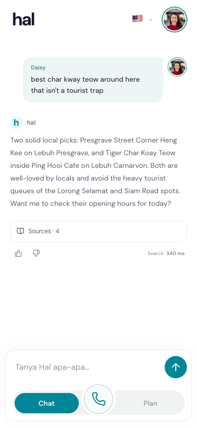
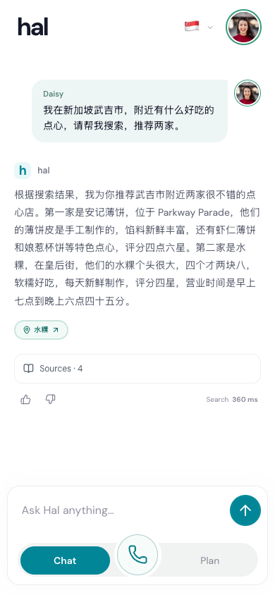

# Hal

A Next.js demo with short Chat answers, hands-free voice, and deeper Plan research.

## iPhone demo

| Hal Chat | Hal Voice | Hal+ Plan |
| --- | --- | --- |
|  |  |  |

Presentation screenshots. Chat and Voice timings are illustrative demo timings, not benchmark measurements. Screenshots may reflect earlier result counts.

## Current search defaults

| Mode | Exa search type | Results | Highlights |
| --- | --- | --- | --- |
| Chat | `lite` | 5 | `true` |
| Voice | `lite` | 4 | `true` |
| Plan | `deep` | 10 | `true` |

Browser favicon: `app/icon.png`. iPhone home-screen icon: `app/apple-icon.png`. Original app icon: `public/brand/hal-app-icon.png`. Next.js supplies the icon metadata links automatically.

## Local setup

Install dependencies with `npm ci`. Add `EXA_API_KEY` and `ELEVENLABS_API_KEY` to the ignored `.env.local` file, then run `npm run setup:voice`. The setup creates a private ElevenLabs agent and an Exa webhook tool, stores the Exa key as a workspace secret, and saves the agent/tool IDs locally. Existing IDs are reused on reruns. Start with `npm run dev` and open http://localhost:3000.

Never prefix credentials with `NEXT_PUBLIC_`. The browser receives only a short-lived signed conversation URL. Local development skips the demo access code; hosted ElevenLabs sessions require `HAL_ACCESS_CODE`.

## Chat and voice

Both use the ElevenLabs agent, configured with Claude Haiku 4.5. No Gemini key or generation code is used. Typed Chat opens a text-only session; the phone button opens an audio conversation with ElevenLabs transcription, turn detection and speech. Microphone permission is required. Muting pauses microphone input; hanging up ends the session. Voice transcripts remain in Chat. Typed answers retain a browser speech-synthesis Listen button.

The agent uses Exa `/search` with `type: lite`: Chat requests 5 results and Voice requests 4, both with `contents.highlights: true`. Do not set `contents.maxAgeHours` for Lite: the live Exa API rejects this combination (verified 24 October 2026). Selected city/country/language are supplied as dynamic context; explicit destinations take precedence. Exa results are untrusted evidence, not instructions. Sources and bold Search latency are shown when provided by the tool response. This latency is Exa's reported search processing time, not total network, generation or speech delay. Real-device voice latency requires separate measurement.

See [Exa's ElevenLabs integration](https://exa.ai/docs/integrations/elevenlabs).

## Plan

`app/api/hal/route.ts` calls Exa Deep on the server. Returned highlights are locally capped to 24,000 characters (roughly 6,000 estimated tokens at four characters per token). This does not constrain Exa's internal generation context. Plan has three free demo runs and a simulated Hal+ upgrade; no payment is taken.

## Location and interface

Singapore is the fallback. Hal requests browser location on load; remembered browser grants/denials determine whether a permission prompt appears. Coordinates go to BigDataCloud's reverse geocoder; known city/country and supplied coordinates are retained for search context. Country selection beside the profile changes the default language and resets the chat. Profile contains membership settings. Hal uses teal; Hal+ uses champagne.

## Deployment

`vercel.json` selects Singapore (`sin1`) for app server functions. This does not determine ElevenLabs' or Exa's infrastructure region. Configure `EXA_API_KEY`, `ELEVENLABS_API_KEY`, `ELEVENLABS_AGENT_ID` and `HAL_ACCESS_CODE` in Vercel, then redeploy. The ElevenLabs workspace tool already holds its Exa secret.

## Validation and limits

Run `npm test` and `npm run build`. Membership is client-side demo state, not production billing. Rate limits are per-process rather than distributed. Historical benchmark outputs describe the previous pipeline and are not measurements of this ElevenLabs integration. Live microphone and audible response checks must be performed on the target device.

### Chat and Voice retrieval profiles

Both use Exa Lite. Chat requests 5 results; Voice requests 4. Both use `contents.highlights: true`. Plan uses Exa Deep with 10 results and the same highlights setting. No beta header is required. The selected country is bound to `userLocation`; city stays in the query context. `lib/search-profiles.mjs` supplies numeric ElevenLabs session variables, which the shared webhook binds directly instead of asking the LLM to choose these parameters.

Existing ElevenLabs setups can apply tool bindings/defaults with `node scripts/update-search-profiles.mjs`. It preserves other agent configuration and updates the local version pin. New sessions are required. Local client changes need deployment before hosted clients send the Chat-specific profile; defaults use the smaller Voice profile.

`node scripts/verify-search-profiles.mjs` tests both retrieval profiles via text-only ElevenLabs sessions (not a microphone/audio test). Live verification returned five and four sources respectively. Automatic highlights vary in length. The local retained-evidence budget is 24,000 characters (approximately 6,000 tokens); this is not a cap on Exa internal synthesis or the ElevenLabs tool response received by its agent.

### Task-specific Exa objectives

Plan and the fallback Chat search use `lib/search-objective.mjs` to prioritise evidence appropriate to the query. The ElevenLabs Chat/Voice tool generates a short per-request objective using the same guidance. Location must not be treated as nationality. Existing Lite/Deep modes and result budgets are unchanged. Run `node scripts/update-search-profiles.mjs` to update the shared remote tool; that change also affects other clients using it, even before a Vercel deployment.

`benchmarks/plan/objectives.mjs` compares baseline, objective, and objective plus official-domain filters on visa and housing questions. Results and review are in `benchmarks/plan/objective-results.json`: visa 20.286 / 17.390 / 18.100 seconds; housing 17.377 / 14.765 / 15.766 seconds. Exa reported US$0.012 per call (US$0.072 total), excluding any external model or voice costs. Each is a single sample, with variants run concurrently, not a p95 or evidence of causal speed improvement. The filtered housing answer still used an unhelpful universal maximum instead of resolving the supplied income tier. Filters remain benchmark-only; official domains do not guarantee correct synthesis. Source checks were selective, not a full citation audit.

### Answer feedback / observability

Each completed answer has Helpful / Unhelpful controls under Sources. A second click removes the vote; the other thumb replaces it. Saved votes persist on this browser. The UI only acknowledges successful server responses and allows retry on errors.

`POST /api/feedback` emits `hal.answer_feedback` JSON events with response ID, rating (`up`, `down`, or `null` for removal), mode (Chat, Voice, Plan), Exa request ID where available, search type, client-reported latency/token estimates and source domains. New voice turns retain their channel; older saved voice turns cannot be distinguished from Chat. Raw prompts, answers, credentials and complete source URLs are excluded. The endpoint validates and allowlists fields, applies the existing demo access/origin policy, and has a per-instance rate limit. These are user-supplied ratings/measurements, not trusted billing or audited provider metrics.

Local development also appends events to `.data/feedback.jsonl` (gitignored). Production emits structured server logs only: configure a log drain or observability store for durable retention and dashboards. No external analytics provider has been connected. Aggregate by responseId using the latest receivedAt event; null removes the rating. Do not count vote changes as additional answers. This is browser-local, unauthenticated demo feedback, not a verified unique-user voting system.
