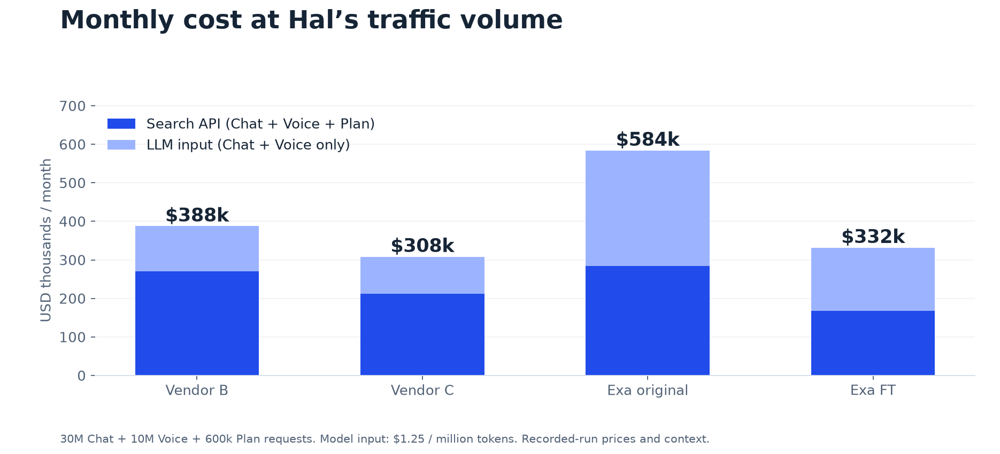

# Hal — better search for everyday answers and Plan

## iPhone demo

| Hal Chat | Hal Voice | Hal+ Plan |
| --- | --- | --- |
|  |  |  |

Presentation screenshots. Chat and Voice timings are illustrative demo timings, not benchmark measurements. Screenshots may reflect earlier result counts.

## What is Hal?

Hal is a mobile AI assistant for everyday questions across Southeast Asia. **Hal Chat and Voice** help users find local places, compare options and get quick answers. **Hal+ Plan** tackles bigger requests such as travel planning and housing grants.

In the case study, Hal serves **3 million monthly users**, with **140,000 Hal+ subscribers**. It handles **40 million quick searches and 600,000 plans a month**. Halcyon is fictional; this repository demonstrates the proposed integration for the exercise.

### Why this matters to the business

Hal already uses Vendor B. Plan drives paid subscriptions, but 26% of plans receive a thumbs-down and 18% of users leave before completion. Cost per answer has risen about 40% this year. The opportunity is to deliver useful, trustworthy plans faster while improving Hal+ margins ahead of the **1 December travel campaign**.

This demo shows how Exa can fit into the existing experience: local context, relevant highlights and a search configuration for each mode.

## Evaluation results

**24 October 2026 · ZingZai · 40 questions**

| Exa FT finding | Result | Why it matters |
| --- | --- | --- |
| Retrieved-evidence quality | **4.53 out of 5; 34 of 40 scored 4 or 5** | More relevant context for Hal’s answers |
| Quick-search p95 | **392 ms** of Exa server time | Measures the search stage, before answer generation |
| Quick-search raw context | **3,039 tokens on average** | 86% less payload than original Exa |
| Modeled monthly cost | **$332k; 14.4% below Vendor B** | About $56k/month potential savings at the stated volume |

Baseline quality judges final answers; FT judges retrieval. Baseline speed is client-timed; FT speed is server-timed. These are encouraging findings, not proof of better final answers or an end-to-end speedup. Vendor C remains the lowest-cost option in this model.

**[Open the results tables, charts and all 40 FT rows](evaluation-results/README.md)** · [Download the PDF](evaluation-results/Search%20provider%20comparison%20FT%20-%20Oct%202026.pdf) · [Download the workbook](evaluation-results/results_exa_fine_tune.xlsx)

The workbook is an earlier local snapshot, preserved unchanged. The README tables and charts use the later report snapshot; see the [source-version note](evaluation-results/README.md#files-and-source-versions).

