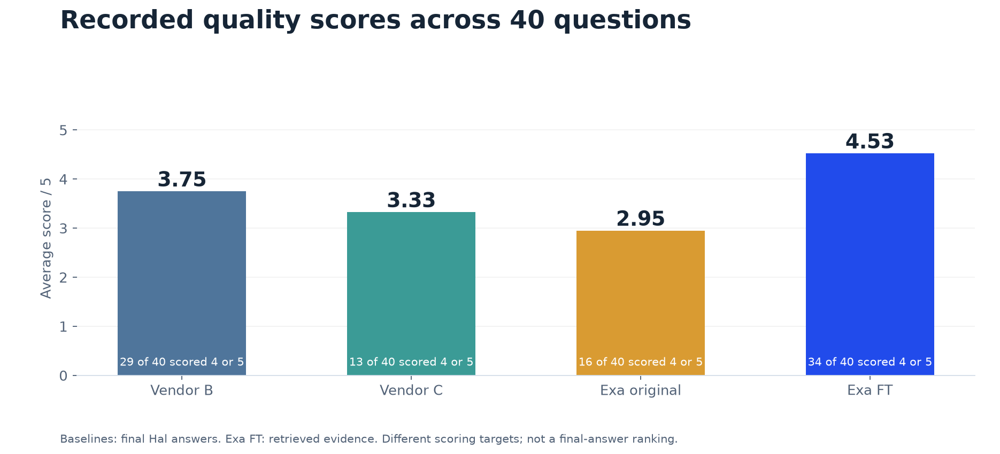
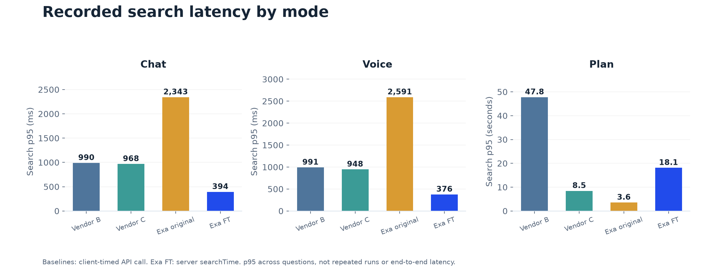
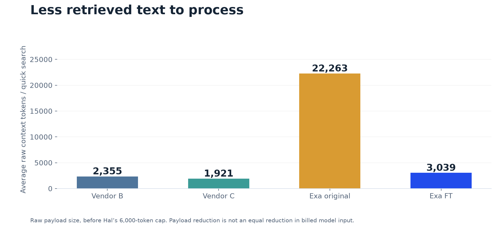

# Evaluation results

**Author: ZingZai · FT evaluation: 24 October 2026 · 40 questions (28 quick, 12 Plan)**

## Summary for the meeting

- **Quality:** Exa FT retrieved evidence averaged **4.53 out of 5**. **34 of 40 questions scored 4 or 5**. Plan still has five questions below 4, so focus the production-LLM review there.
- **Context:** quick-search payloads average **3,039 tokens**, down **86%** from original Exa. Highlights reduce the amount of text Hal needs to process.
- **Cost:** approximately **$332k/month**, **14.4% below incumbent Vendor B** (about $56k/month). Vendor C remains cheaper at about $308k.
- **Speed:** recorded FT quick-search p95 is **392 ms**. This is Exa server time; baseline measurements include the client-to-provider call. Do not describe the difference as a verified end-to-end speedup.

FT means **Exa API configuration**, not model-weight fine-tuning. Baseline quality scores assess Hal answers; FT scores assess retrieved evidence. The business opportunity is better context and lower modeled cost; final-answer quality, citation support and peak-load reliability still need validation in Hal.

## Files and source versions

- [FT comparison report](Search%20provider%20comparison%20FT%20-%20Oct%202026.pdf): presentation report, including API examples and evaluation-script instructions.
- [Evaluation workbook](results_exa_fine_tune.xlsx): updated to match all 40 FT rows below, including scores, judge notes, search metrics, costs, actual questions and user locations.
- The workbook, tables and charts use the **same saved 40-row snapshot that generated the FT report**. The workbook was synchronised on 25 October 2026; no searches or judging were rerun.
- Current app defaults are Chat 5, Voice 4, Plan 10 results with `highlights: true`. Historical run settings varied; these are historical results, not a fresh benchmark of the current defaults.

## Comparison at a glance

| Metric | Vendor B | Vendor C | Exa original | Exa FT |
| --- | --- | --- | --- | --- |
| Average recorded score (out of 5) | 3.75 | 3.33 | 2.95 | 4.53 |
| Quick questions: average score | 3.75 | 3.39 | 3.00 | 4.82 |
| Plan: average score | 3.75 | 3.17 | 2.83 | 3.83 |
| Questions scoring 4 or 5 (out of 40) | 29 | 13 | 16 | 34 |
| Quick search p50 (ms) | 650 | 687 | 1,267 | 355 |
| Quick search p95 (ms) | 1,084 | 959 | 2,431 | 392 |
| Voice search p50 (ms) | 682 | 660 | 1,337 | 345 |
| Plan search p50 (seconds) | 37.8 | 6.1 | 1.9 | 12.1 |
| Raw context tokens per quick search | 2,355 | 1,921 | 22,263 | 3,039 |
| Modeled monthly cost (USD) | $388k | $308k | $584k | $332k |

p50 = median; p95 = inclusive 95th percentile across the recorded questions. One saved result per question; no cold-cache guarantee. Tokens are estimated as characters / 4.

## Quality

### Exa FT by intent

| Intent | Questions | Average score / 5 | Scored 4 or 5 |
| --- | --- | --- | --- |
| Local | 7 | 4.86 | 7 |
| News | 5 | 5.00 | 5 |
| Travel | 6 | 5.00 | 6 |
| Shopping | 4 | 5.00 | 4 |
| General | 6 | 4.33 | 5 |
| Plan | 12 | 3.83 | 7 |

## Speed

Search timing excludes answer generation and speech playback. These results cannot establish Hal’s end-to-end targets.

## Cost

| Monthly cost (USD) | Vendor B | Vendor C | Exa original | Exa FT |
| --- | --- | --- | --- | --- |
| Search | $270,000 | $212,000 | $284,200 | $167,200 |
| Model input (quick only) | $117,611 | $96,360 | $299,956 | $164,645 |
| Total | $387,611 | $308,360 | $584,156 | $331,845 |

Assumptions: 40M quick searches/month, split 75% Chat and 25% Voice; 600k Plan requests/month separately. Model input is $1.25 per million tokens. Search cost uses recorded mean cost by mode; input cost uses recorded retained tokens. Excludes Plan model input, model output, voice generation, retries, geocoding and enterprise discounts.

## Context size

## All 40 Exa FT results

Scores evaluate retrieved evidence. Search time is Exa server searchTime in milliseconds; cost is the recorded search cost per request.

| ID | Question | user_country | user_city | Intent | Mode | Score / 5 | Search ms | Tokens used | Search USD | judge_note |
| --- | --- | --- | --- | --- | --- | --- | --- | --- | --- | --- |
| q01 | good laksa near me that's open late | SG | Tanjong Pagar | Local | Chat | 5 | 373.6 | 4,558 | $0.0040 | Evidence identifies Sin Xiong Noodle House located at Hoe Chiang Road near Tanjong Pagar MRT, which serves traditional laksa and is open late (Mon-Sat until 11:59 pm). Other local laksa options and late-night spots are also detailed. |
| q02 | best char kway teow around here that isn't a tourist trap | MY | George Town, Penang | Local | Chat | 5 | 380.9 | 4,503 | $0.0040 | The evidence provides multiple specific local char kway teow stalls in George Town avoiding typical tourist traps (e.g., Barefoot CKT at Cecil Street Market, No. 5 Char Koay Teow, Heng Kee on Presgrave Street, FirYan, and 850 Char Koay Teow) complete with locations, timings, and local reviews. |
| q03 | any good brunch places nearby | MY | Bangsar, Kuala Lumpur | Local | Voice | 5 | 380.1 | 1,553 | $0.0040 | The retrieved evidence provides multiple highly rated brunch spots in Bangsar, Kuala Lumpur (e.g., Antipodean Cafe, Alta Café, Plump, Breakfast Thieves, Nutmeg) with addresses, vibe descriptions, and menu highlights. |
| q04 | kid-friendly things to do near me on a rainy day | PH | BGC, Taguig | Local | Chat | 5 | 392.6 | 4,501 | $0.0040 | Excellent coverage directly matching the prompt constraints. Provides varied indoor, kid-friendly rainy-day options in/near BGC (The Mind Museum, ActiveFun BGC, Kidzooona / Kids Box Mitsukoshi, Wetpark Adventure Lagoon, and WiiJump) with locations, activities, hours, and pricing. |
| q05 | vegetarian restaurants near me | TH | Ari, Bangkok | Local | Chat | 5 | 385.0 | 4,504 | $0.0040 | The evidence provides multiple specific vegetarian and vegan restaurants in and around Ari, Bangkok (e.g., Bamboo Garden Healthy Vegetarian Foods, O'ganic Concept ARI, Lust Ramen @Ari vegan menu, Jones' Salad, Aroi Ari), complete with locations and details. |
| q06 | nearest polyclinic and when it's open | SG | Punggol | Local | Voice | 5 | 371.9 | 1,513 | $0.0040 | Evidence confirms the nearest polyclinic in Punggol is SingHealth Polyclinics - Punggol at Oasis Terraces, along with its specific operating hours (Mon-Fri 8 AM-1 PM, Sat 8 AM-12:30 PM, closed Sunday). |
| q07 | 附近有什么好吃的点心 | SG | Bugis | Local | Chat | 4 | 361.5 | 4,503 | $0.0040 | The query asks for '点心' (dim sum / snacks / desserts). The results provide a dim sum option (Hong Kong Dim Sum Shop on Liang Seah St) and numerous traditional/modern dessert & snack places (Ah Chew Dessert, Yat Ka Yan, Dessert First, Ji Xiang Ang Ku Kueh) in Bugis. |
| q08 | is Malaysia's minimum wage going up? | MY | Kuala Lumpur | News | Chat | 5 | 294.9 | 3,072 | $0.0040 | The retrieved evidence provides clear, authoritative, and up-to-date reporting showing that in Budget 2027 (announced October 2026), the Malaysian government decided to raise the minimum wage from RM1,700 to RM2,000 effective June 2027. |
| q09 | what's the latest on the RTS Link opening date | SG | Woodlands | News | Chat | 5 | 324.9 | 3,170 | $0.0040 | The retrieved articles provide the latest official updates (from October 2026) regarding the RTS Link opening date, noting passenger service is now targeted for February 2027 subject to final safety certifications and regulatory approvals. |
| q10 | who won the Singapore Grand Prix | SG | Tampines | News | Voice | 5 | 333.3 | 1,429 | $0.0040 | The evidence directly confirms that Max Verstappen won the most recent Singapore Grand Prix on October 11, 2026, satisfying all aspects of the query. |
| q11 | what's in Budget 2027 for students | MY | Petaling Jaya | News | Voice | 5 | 356.8 | 1,563 | $0.0040 | Evidence includes the official Budget 2027 speech and detailed reporting covering key student initiatives: RM2,500 Form Six allowance, RM200 Bantuan Awal Persekolahan, RM870m food programme, RM750m student housing, and RM5 meals. |
| q12 | berita terbaru harga BBM Pertamina | ID | Surabaya | News | Chat | 5 | 335.4 | 3,742 | $0.0040 | Comprehensive current evidence provides updated fuel prices for Pertamina as of October 24, 2026 across Indonesia including Jawa Timur/Surabaya (Pertalite, Biosolar, Pertamax series, Dexlite, Pertamina Dex), fulfilling the query completely. |
| q13 | do I need to fill in an arrival card for Thailand | SG | Toa Payoh | Travel | Chat | 5 | 318.7 | 2,285 | $0.0040 | Evidence confirms that foreign nationals must submit the Thailand Digital Arrival Card (TDAC) online within 3 days prior to arrival starting May 1, 2025. |
| q14 | how long can Malaysians stay in China without a visa | MY | Cheras, Kuala Lumpur | Travel | Chat | 5 | 352.6 | 3,644 | $0.0040 | Authoritative evidence from the Chinese Embassy and consular notices shows ordinary Malaysian passport holders can stay visa-free for up to 30 days per entry (up to 90 days per 180-day period). |
| q15 | fastest way to Marina Bay from the airport at 1am | SG | Changi Airport | Travel | Voice | 5 | 322.9 | 1,501 | $0.0040 | The evidence clearly indicates that the last MRT leaves around 23:18 / 00:06, making taxi, Grab, or private car the fastest option at 1am, taking approximately 20-30 minutes. |
| q16 | do Singaporeans need a visa for Japan | SG | Clementi | Travel | Chat | 5 | 326.1 | 3,507 | $0.0040 | The retrieved evidence from the Singapore MFA and the Embassy / MOFA of Japan clearly confirms that Singapore passport holders do not require a visa for short-term visits to Japan (up to 90 days). |
| q17 | what's the baggage allowance on Cebu Pacific GO Basic | PH | Cebu City | Travel | Chat | 5 | 390.1 | 2,817 | $0.0040 | The evidence explicitly confirms that the GO Basic fare includes 7 kg hand-carry baggage (one overhead and one personal item) and no checked baggage (available only as a paid add-on). |
| q18 | how do I get from KLIA to KL Sentral | MY | Sepang | Travel | Voice | 5 | 340.1 | 1,501 | $0.0040 | The evidence comprehensively outlines options to get from KLIA to KL Sentral, including KLIA Ekspres (28 minutes), KLIA Transit (approx. 35 minutes), buses, and taxis/e-hailing. |
| q19 | best budget noise-cancelling earbuds under 150 dollars | SG | Orchard | Shopping | Chat | 5 | 398.8 | 4,510 | $0.0040 | The evidence provides multiple specific models available in Singapore under S$150 with active noise cancelling and SGD prices (e.g., Soundcore Liberty 5 at S$99, Sony WF-C710N at S$109-148.80, Nothing Ear (a) at S$88-129, and Honor Earbuds 4 at S$78-99), backed by reviews and retailer listings in Singapore. |
| q20 | cheapest place to buy an iPhone 17 in Malaysia | MY | Shah Alam | Shopping | Chat | 5 | 357.0 | 3,171 | $0.0040 | The retrieved evidence provides official Apple Malaysia pricing (RM 4,299) as well as authorized and third-party retailer pricing across Malaysia/Shah Alam (e.g., Carousell at RM 3,599, CHN Shop at RM 3,959, DirectD at RM 3,999, Machines at RM 4,219). |
| q21 | is the Dyson V15 worth it or should I get something cheaper | SG | Sengkang | Shopping | Chat | 5 | 378.0 | 4,566 | $0.0040 | Evidence provides balanced reviews on whether the Dyson V15 is worth it, specific cheaper alternatives (Airbot from ~S$185.90, Shark cordless ~S$299, Samsung Bespoke Jet, V12/V8), and current Singapore pricing. |
| q22 | which SIM card should I buy at the airport | TH | Suvarnabhumi Airport | Shopping | Voice | 5 | 340.6 | 1,500 | $0.0040 | Evidence specifically covers tourist SIMs available at Suvarnabhumi Airport arrivals hall from all three major operators (AIS, dtac, TrueMove H), including comparison guidance, current October 2026 pricing, and data allowances. |
| q23 | how do I make kaya at home | SG | Ang Mo Kio | General | Chat | 5 | 346.2 | 4,554 | $0.0040 | The evidence provides detailed, step-by-step recipes for making kaya at home, including required ingredients (eggs/yolks, coconut milk/cream, sugar, pandan leaves) and cooking techniques (such as using a double boiler or saucepan). |
| q24 | what's the difference between CPF OA and SA | SG | Bedok | General | Chat | 5 | 390.8 | 3,844 | $0.0040 | The evidence thoroughly explains the differences between CPF OA and SA, covering their purposes (housing/education/investments vs retirement), interest rates (2.5% vs 4% floor/up to 5%), and the closure of SA for members aged 55 and above. |
| q25 | how does ERP 2.0 work | SG | Hougang | General | Chat | 5 | 328.6 | 4,502 | $0.0040 | The evidence explains how ERP 2.0 works using Global Navigation Satellite Systems (GNSS) via an On-Board Unit (OBU), the role of gantries during the transition phase, and the status of distance-based charging. |
| q26 | how do I renew my passport | SG | Yishun | General | Voice | 5 | 324.5 | 1,501 | $0.0040 | The retrieved evidence clearly provides the procedures for renewing a Singapore passport via ICA's online e-service, including photo requirements, processing times, fees, and collection options. |
| q27 | what's the weather in KL right now | MY | Kuala Lumpur | General | Voice | 5 | 350.1 | 1,566 | $0.0040 | The evidence provides detailed, up-to-date current weather conditions and temperatures for Kuala Lumpur on the evaluation date. |
| q28 | remind me to call mum at 7pm | SG | Serangoon | General | Voice | 1 | 362.8 | 1,501 | $0.0040 | The user prompt is a direct conversational command to set a reminder, but the retrieved web documents are generic guides/tutorials on how to set reminders in Siri or Reminders apps. |
| q29 | Plan a 3-day trip to Penang from Singapore for a family with a 4-year-old: the cheapest way to get there, halal food each day, and one indoor option per day in case it rains. | SG | Toa Payoh | Plan | Plan | 3 | 21,663.2 | 3,002 | $0.0120 | Evidence supports cheapest transport (overnight bus via KL/direct bus SGD 15-33) and multiple halal dining spots (The Lengkuas Cafe, Canning Dim Sum, The Table Penang). However, for indoor rainy-day activities, only The Top Penang is detailed; missing distinct indoor options for all 3 days. |
| q30 | My wife and I are both 32 and earn S$9,000 a month together. We want to buy a 4-room HDB resale flat near her parents in Tampines. Which grants can we get, how much in total, and what's the most HDB will lend us and at what interest rate? | SG | Punggol | Plan | Plan | 3 | 13,768.8 | 3,004 | $0.0120 | Evidence covers CPF Family Grant ($80k for 4-room resale SC/SC), Proximity Housing Grant ($20k within 4km), HDB loan LTV (up to 75%), interest rate (2.6%), and MSR cap (30%). However, details and income bracket tiers for the Enhanced CPF Housing Grant (EHG) amount at S$9,000 monthly income are missing. |
| q31 | What's the cheapest way to get from KL Sentral to Orchard Road this Saturday? Compare bus, train and flight with prices and total door-to-door time, including getting to and from the stations or airports. | MY | Kuala Lumpur | Plan | Plan | 2 | 15,232.3 | 3,003 | $0.0120 | Evidence gives details for flight (costs, door-to-door transit) and train (ETS + Shuttle Tebrau + MRT/Woodlands, fares and travel times). However, direct bus from KL to Singapore is not detailed with specific prices or journey times to Orchard Road, preventing a complete 3-way comparison. |
| q32 | What's the easiest way for a Filipino to get a Japan tourist visa, how long does it take and what documents do I need? | PH | Quezon City | Plan | Plan | 5 | 15,138.7 | 3,003 | $0.0120 | The evidence fully covers how to apply (JVAC / VFS Global), processing time (standard 5 working days, longer if checking needed), and comprehensive lists of required documents (passport, photo dimensions, application form, PSA certificates, bank certificate, ITR/Form 2316, COE, itinerary, guarantee letter). |
| q33 | Compare the 3 cheapest SIM-only mobile plans in Singapore with at least 100GB of data: price, contract, network, and whether 5G is included. | SG | Jurong West | Plan | Plan | 5 | 8,287.2 | 3,003 | $0.0120 | Evidence contains details for multiple SIM-only plans with >=100GB data, including the cheapest options (e.g., Zero1 Starter Prime at S$7.06, CMLink 200GB at S$7.70, MyRepublic 4G Vibe at S$7.90, Circles Core at S$8.00) along with price, contract status (no contract), network, and 5G inclusion status. |
| q34 | Which Singapore credit cards give the most miles per dollar on overseas spending right now? Give me the top 3 with the earn rate, annual fee and the minimum income to apply. | SG | Bishan | Plan | Plan | 5 | 10,505.6 | 3,002 | $0.0120 | The retrieved results provide authoritative information on top miles-earning cards for overseas spend (UOB PRVI Miles up to 3 mpd, StanChart Visa Infinite up to 3 mpd, UOB Visa Infinite Metal 3 mpd, DBS Vantage/Altitude 2.2 mpd), complete with exact earn rates, annual fees, and minimum income criteria. |
| q35 | I'm a Form 6 student in Selangor. What did Budget 2027 announce for students like me, and how do I apply? | MY | Petaling Jaya | Plan | Plan | 3 | 14,086.4 | 3,001 | $0.0120 | Evidence confirms the Budget 2027 measure for Form 6 students: an RM2,500 living allowance matching matriculation rates. However, there is no evidence provided on how Form 6 students apply for or receive this newly announced allowance (only general pra-u admissions and old BKP/BAP scholarship info are shown). |
| q36 | Plan a one-day food crawl in Chiang Mai's Old City on a Sunday: 5 stops in walking order, with opening hours, what to order at each and a rough price. | TH | Chiang Mai | Plan | Plan | 4 | 14,686.1 | 3,004 | $0.0120 | There is ample evidence for Sunday dining options in/around Chiang Mai Old City (including Sunday Walking Street stalls, Huan Kung Kum, Huen Phen, Kuay Chap Sam Ka Sat, MALA BBQ), along with opening hours, dish recommendations, and rough prices in THB. Minor gaps exist around specific dish prices/details for a few individual named venues. |
| q37 | Which hawker stalls near Tampines are in the latest Michelin Bib Gourmand list, what should I order at each, and what are their opening hours? | SG | Tampines | Plan | Plan | 5 | 8,485.9 | 2,834 | $0.0120 | All requested details are fully backed by the evidence: the two Bib Gourmand hawker stalls at Tampines Round Market (Rajarani Thosai and Yi Pin Wei Braised Duck Kway Chap), their specific opening hours, and dishes to order. |
| q38 | Rekomendasikan 3 laptop untuk mahasiswa di bawah Rp10 juta yang dijual di Indonesia sekarang, bandingkan spesifikasi dan harganya. | ID | Bandung | Plan | Plan | 4 | 8,034.1 | 2,627 | $0.0120 | Finds Indonesian laptop models under Rp10 million with specifications and prices. Exact current stock and like-for-like configurations need checking. |
| q39 | We're flying Singapore Airlines to Tokyo in December with our 2-year-old. What's her baggage allowance, can we take the stroller to the gate, and does she need anything to enter Japan? | SG | Clementi | Plan | Plan | 3 | 4,096.8 | 3,002 | $0.0120 | Official sources support stroller handling and Japan entry rules, but baggage highlights focus on infants rather than the requested two-year-old child. |
| q40 | I commute from JB to Singapore every day. When does the RTS Link open, what will the fare be, how much time will it save me versus the Causeway bus, and what happens to the KTM Shuttle Tebrau? | MY | Johor Bahru | Plan | Plan | 4 | 7,588.2 | 2,833 | $0.0120 | Finds current RTS opening reports, unannounced fare status and official Shuttle Tebrau policy. End-to-end time savings remain estimates. |
